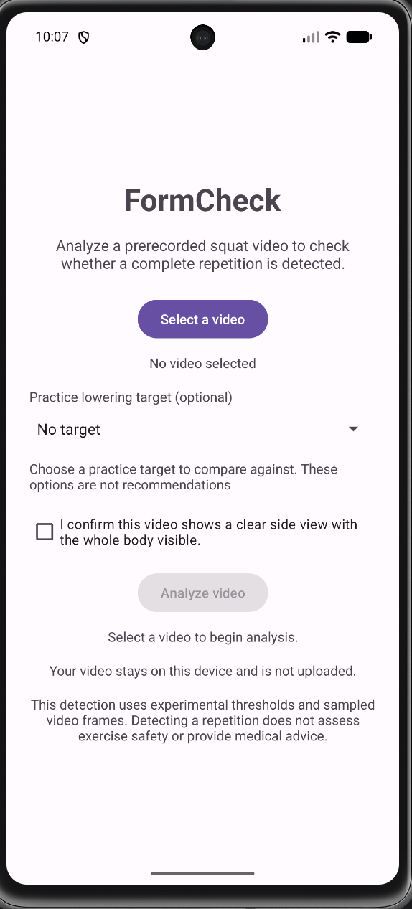
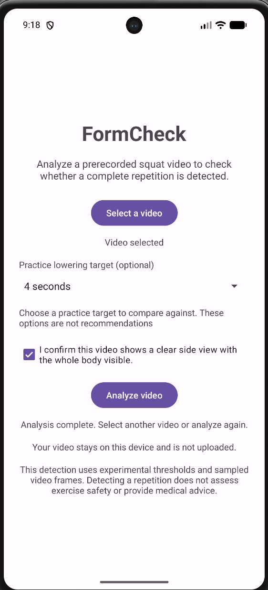
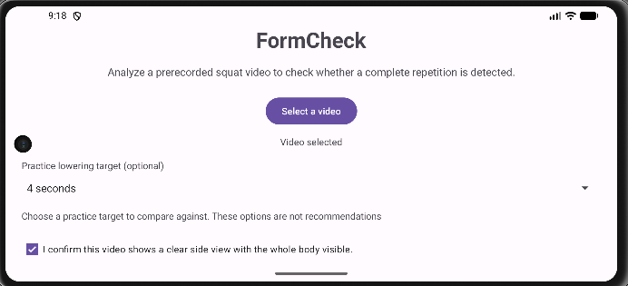
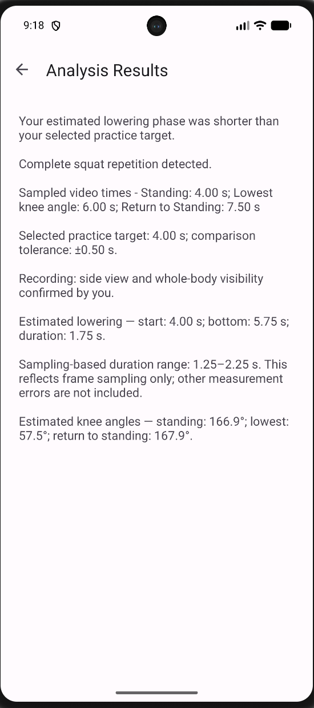
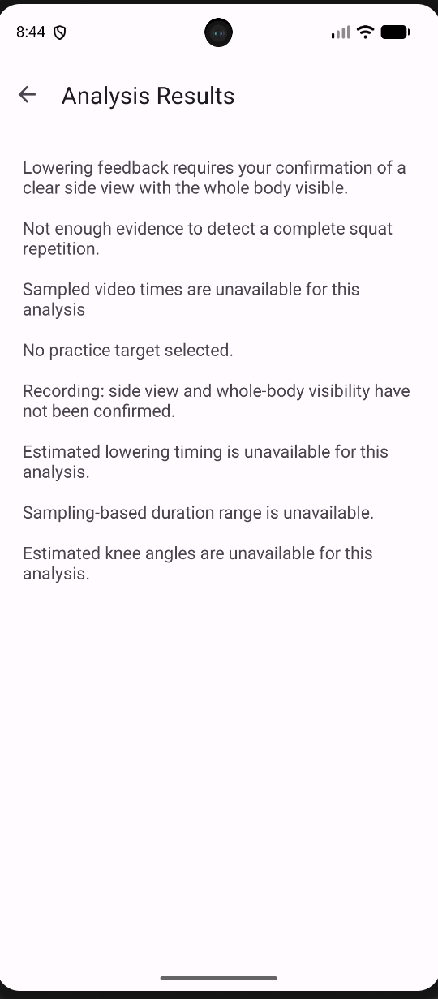

# FormCheck

FormCheck is an experimental Android app that analyzes prerecorded squat videos on your device. It detects the first complete repetition supported by the sampled observations, displays estimated knee angles and video times, and compares estimated lowering duration with an optional practice target you choose.

AI assistance is documented in [AI_USE_LOG.md](docs/AI_USE_LOG.md).

## Download

**[Download FormCheck 1.0 for Android](https://github.com/cluelessfr/FormCheck/releases/download/v1.0/FormCheck-1.0.apk)**

- Requires Android 7.0 (API 24) or later.
- The signed APK is approximately 60.6 MB.
- [Release notes and SHA-256 checksum](https://github.com/cluelessfr/FormCheck/releases/tag/v1.0).

Download the `.apk` file, open it on your Android device, and follow the installation prompts. Android may ask you to allow installation from the browser or file manager you used. Installation availability also depends on device policies and Android developer-verification requirements in your region.

If you previously installed a debug version, you may need to uninstall it first because it uses a different signing key. Uninstalling clears FormCheck's app data. The source-code ZIP on the release page is for development; install the APK to use the app.

## Demo video and screenshots

All five screenshots below and the demo video were captured on an Android emulator. They show example app behavior in that environment; they do not establish measurement accuracy or physical-device performance.

### Video walkthrough

[Watch or download the FormCheck emulator demo (MP4, 1 min 20 sec, approximately 33 MB)](docs/media/formcheck-emulator-demo.mp4)

The recording has no audible narration. It shows selecting a video and a four-second practice target, processing frames, viewing a detected repetition, cancelling another analysis, and viewing an insufficient-evidence result. The final sequence selects an invalid test file and shows the analysis-failure message.

### Home and video selection

| Home screen | Analysis complete |
| --- | --- |
|  |  |

### Landscape view



This landscape capture shows the upper portion of the screen; the analysis controls are not visible in this image.

### Example results

| Complete repetition detected | Measurements unavailable |
| --- | --- |
|  |  |

These screenshots illustrate the app interface and example outputs; they do not establish measurement accuracy.

## How to use it

1. Open FormCheck and tap **Select a video**.
2. Select a prerecorded squat video. Use a clear side view with the whole body visible for lowering feedback.
3. Optionally select a practice lowering target of 1, 2, 3, or 4 seconds. These choices are not recommendations. The comparison tolerance is 0.50 seconds.
4. Check the recording-confirmation box only if the video meets its description. This is your confirmation; the app does not automatically classify the camera view.
5. Tap **Analyze video** and keep FormCheck open while it processes the frames. Processing time varies with the video and device.
6. Read the results on the separate results screen. Use the back arrow to return to the selected video.

**Cancel analysis** appears while processing. Cancelling preserves your inputs and lets you try again. Rotating the screen or leaving the app during analysis also interrupts the work and requires a retry; analysis does not resume in the background. The current frame may finish before processing stops.

## Results

- Complete-repetition detection or an insufficient-evidence message.
- Sampled video times for standing, the lowest observed knee angle, and return to standing.
- Estimated knee angles at those three samples.
- Estimated lowering start, bottom boundary, and duration.
- A sampling-based duration range.
- Comparison with your selected target: shorter, near, longer, or unavailable with an explanation.

Sampled video times are positions within the video. The lowest-angle sample and the estimated lowering-bottom boundary are separate measurements and may have different timestamps. Missing measurements are displayed as unavailable.

## Privacy and limitations

Video processing happens locally. FormCheck does not upload your selected video, and the pose model is included in the app.

FormCheck is an educational prototype. It does not assess exercise safety, provide medical advice, or assign a good-form score. Timing, angles, and detection thresholds are experimental and have not been independently validated for broad accuracy.

The app samples frames every 250 milliseconds. Its sampling-based duration range reflects frame sampling only; it does not account for all pose-estimation, camera, perspective, or algorithm errors. Feedback is withheld when the range does not support a single comparison category. Occlusion, unclear landmarks, gaps, and unsuitable views can limit results. Only the first detected complete repetition is reported.

## Development

The app uses Java, XML layouts, and MediaPipe Pose Landmarker Full. Open this repository in Android Studio with Android SDK 37 installed. Use Android Studio's bundled JDK and the included Gradle wrapper; local SDK paths belong in the untracked `local.properties` file.

From the repository root on Windows PowerShell:

```powershell
.\gradlew.bat :app:testDebugUnitTest :app:assembleDebug :app:compileDebugAndroidTestJavaWithJavac
```

With an emulator or Android device connected, run the focused lifecycle and navigation checks:

```powershell
.\gradlew.bat :app:connectedDebugAndroidTest "-Pandroid.testInstrumentationRunnerArguments.class=com.taran.formcheck.ActivityLifecycleInstrumentedTest"
```

These commands require `JAVA_HOME` to point to a compatible JDK. Add `--offline` only when the required Gradle dependencies are already cached. Android-test compilation alone does not execute device tests. Other instrumented tests include video/model processing and may take longer.

For version 1.0, verification included 91 passing JVM tests, five focused emulator tests, large-text/light/dark layout checks, and developer-reported installation and analysis with the signed APK. Layout checks use fixture results; the background-state check uses a controlled task, while the cancel/retry check submits video analysis. These checks verify app behavior, not measurement accuracy or compatibility with every device.

To generate your own release APK, use Android Studio's **Build > Generate Signed App Bundle or APK** workflow and your own signing key. Keep keystores and passwords out of Git.

## Project notes and credits

- [Model and demonstration-video sources](docs/MODEL_SOURCES.md)
- [Feedback research and scope](docs/FEEDBACK_RESEARCH.md)
- [Feedback evaluation and its limits](docs/FEEDBACK_EVALUATION.md)
- [AI-use disclosure](docs/AI_USE_LOG.md)

FormCheck source code is available under the [MIT License](LICENSE). Third-party model and media licensing is documented in the source notes above.
